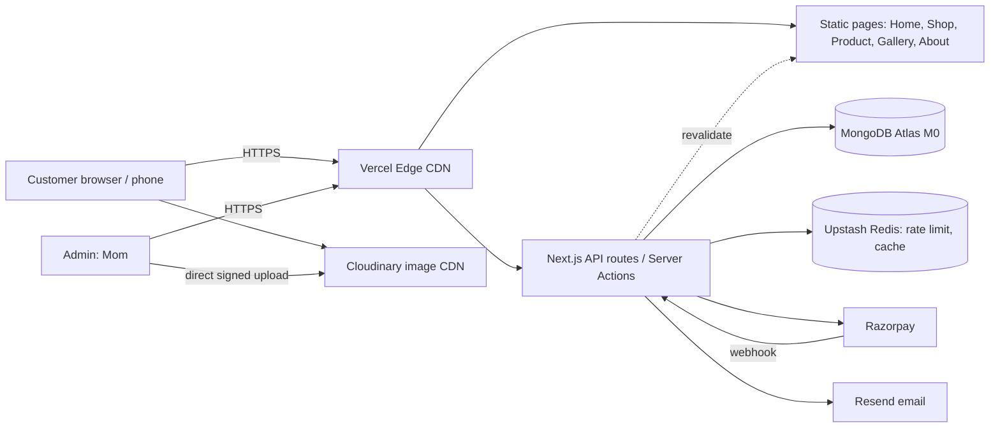

# Architecture

## 1. Principles
- **Static first, dynamic where needed.** Public pages are pre-rendered and served from a CDN; only cart, checkout, admin and tracking hit the server.
- **Serverless and free-tier friendly.** No servers to manage.
- **Portable.** Plain Next.js and Node APIs, no host-specific features that block a move to Cloudflare/Netlify.
- **Images never live in the database.** They live on a CDN.

## 2. Tech Stack
| Layer | Choice | Why |
|-------|--------|-----|
| Framework | **Next.js 15 (App Router) + React + TypeScript** | SSG/ISR for speed and SEO, API routes in the same repo |
| Styling | **Tailwind CSS** + CSS variables for tokens | Fast, consistent, small CSS |
| UI primitives | **Radix UI / shadcn/ui** | Accessible components, we control the style |
| Animation | **Framer Motion** (used sparingly) | Smooth micro-interactions |
| State | **Zustand** (cart), **React Hook Form + Zod** (forms) | Tiny and simple |
| Database | **MongoDB Atlas M0** with **Mongoose** (or the native driver) | Requested; flexible product schema |
| Auth | **Auth.js (NextAuth)**: Google + email OTP for customers, credentials for admin | Free, well supported |
| Payments | **Razorpay** (UPI, cards, netbanking) + COD | Best fit for India |
| Images | **Cloudinary** free tier; fallback: optimised files in `/public` + `next/image` | Transforms, WebP/AVIF, CDN |
| Email | **Resend** (React Email templates) | Free tier, simple API |
| Cache / rate limit | **Upstash Redis** + `@upstash/ratelimit` | Serverless-friendly, free tier |
| Search | MongoDB text index (start); Atlas Search later | No extra service |
| PDF | Pages pre-converted to WebP; viewer via custom React component (or `react-pageflip`) | Fast, no heavy PDF.js bundle |
| Hosting | **Vercel** (see warning) or **Cloudflare Pages / Netlify** | Free CDN and deploys |
| Monitoring | **Sentry**, **Vercel Analytics** / Umami, Uptime Kuma or UptimeRobot | Free |
| CI | GitHub Actions: lint, typecheck, test | Free |
| Testing | Vitest (unit), Playwright (E2E) | Standard |

> **Hosting warning:** Vercel Hobby is for non-commercial use per its terms. Verify before launch. The architecture below works unchanged on Cloudflare Pages or Netlify.

## 3. System Diagram


## 4. Request Flows

### 4.1 Browsing (99% of traffic)
Browser -> CDN cache hit -> pre-rendered HTML + images from Cloudinary CDN. **No database call.**
When admin edits a product -> API calls `revalidateTag('products')` -> pages regenerate on next visit.

### 4.2 Checkout and Payment
1. Client sends cart (product IDs + qty) and address to `POST /api/checkout`.
2. Server re-reads products from DB, recomputes totals, atomically reserves stock.
3. Server creates a Razorpay order, saves `Order{status: pending}`, returns the `razorpay_order_id`.
4. Client opens Razorpay checkout and the customer pays.
5. Client calls `POST /api/payment/verify` with the signature; the server verifies the HMAC and marks the order **paid**.
6. **Webhook** `POST /api/webhooks/razorpay` independently confirms (handles closed-tab cases; idempotent).
7. Emails are sent; admin is alerted. Unpaid orders expire after 15 minutes and stock is released (cron or lazy check).

COD: same, but payment status is `cod_pending` after phone-OTP verification.

### 4.3 Admin Image Upload
Admin form -> server returns a **signed Cloudinary upload** -> browser uploads directly to Cloudinary (no Vercel body-size limit) -> URL and publicId saved with the product.

## 5. Folder Structure
```
madhubani-store/
├─ srs/                      # these documents
├─ assets-source/            # original photos + PDF (not deployed)
├─ scripts/                  # image-optimise, pdf-to-images, seed, backup
├─ public/                   # favicons, patterns, static assets
├─ src/
│  ├─ app/
│  │  ├─ (site)/             # public pages
│  │  │  ├─ page.tsx         # Home
│  │  │  ├─ shop/            # list + [slug]
│  │  │  ├─ gallery/
│  │  │  ├─ about/  contact/  policies/
│  │  │  ├─ cart/  checkout/  order/[id]/
│  │  │  └─ track/
│  │  ├─ admin/              # protected dashboard
│  │  └─ api/                # checkout, payment, webhooks, upload, contact, auth
│  ├─ components/            # ui/, layout/, product/, gallery/, checkout/, admin/
│  ├─ lib/                   # db.ts, razorpay.ts, cloudinary.ts, mail.ts, ratelimit.ts, utils
│  ├─ models/                # Mongoose schemas
│  ├─ schemas/               # Zod schemas (shared)
│  ├─ store/                 # Zustand cart store
│  ├─ styles/                # globals.css, tokens
│  └─ types/
├─ tests/                    # unit + e2e
├─ .env.example
└─ package.json
```

## 6. Data Model (MongoDB)
Money in **paise (integers)**. All collections have `createdAt`, `updatedAt`.

**products**
```
_id, slug (unique), name, description, story,
category (ref), tags[], 
price, compareAtPrice?, 
type: "original" | "print" | "product" | "made_to_order",
stock, 
dimensions { widthCm, heightCm }, medium, 
images [{ url, publicId, alt, width, height, blurDataURL }],
status: "draft" | "published" | "sold" | "archived",
featured, seoTitle?, seoDescription?, deletedAt?
```
Indexes: `slug` unique; `{status, category, price}`; `{status, featured}`; text index on `name, tags, description`.

**categories**: `_id, name, slug, image, order`

**orders**
```
_id, orderId ("MA-241031-0001"), 
customer { name, phone, email }, 
shippingAddress { line1, line2, city, state, pincode, country },
items [{ productId, name, image, price, qty }],
subtotal, shipping, discount, total,
payment { method: "razorpay"|"cod", status, razorpayOrderId, razorpayPaymentId, paidAt },
status: "pending"|"confirmed"|"packed"|"shipped"|"delivered"|"cancelled"|"refunded",
tracking { courier, number, url }, 
statusHistory [{ status, at, note }], expiresAt (TTL for unpaid)
```
Indexes: `orderId` unique; `{customer.phone}`; `{status, createdAt}`; TTL on `expiresAt` for pending only.

**gallery**: `_id, title, image, theme, year, productId?, order, published`
**pages / settings**: `shippingRules, freeShippingAbove, codLimit, announcement, contactInfo, portfolioPdfUrl, portfolioPages[]`
**users**: `_id, email, name, role: "customer"|"admin"` (managed by Auth.js adapter)
**contactMessages**: `_id, name, email, phone, message, type: "enquiry"|"custom_order", attachments[]`

## 7. API Surface (summary)
| Method | Route | Auth | Purpose |
|--------|-------|------|---------|
| GET | `/api/products` | public (cached) | List/filter/search |
| POST | `/api/checkout` | public + rate limit | Validate cart, create order and Razorpay order |
| POST | `/api/payment/verify` | public | Verify signature |
| POST | `/api/webhooks/razorpay` | signature | Source of truth for payments |
| GET | `/api/orders/track` | phone + orderId | Order tracking |
| POST | `/api/contact` | public + rate limit | Enquiry / custom order |
| POST | `/api/otp/send` `verify` | public + rate limit | COD and customer verification |
| CRUD | `/api/admin/products` `orders` `gallery` `settings` | **admin** | Dashboard |
| POST | `/api/admin/upload-sign` | **admin** | Signed Cloudinary upload |

## 8. Handling Traffic on Free Tiers
| Technique | Effect |
|-----------|--------|
| SSG/ISR + CDN for all public pages | Almost no compute or DB use per visit |
| On-demand revalidation instead of polling | DB hit only when content changes |
| Cloudinary/Next image CDN + long cache headers | Images (heaviest bytes) never hit our server |
| Cached `MongoClient` + indexes + `lean()` queries + projections | Avoids exhausting Atlas M0 connections (limit about 500) |
| Rate limiting (Upstash) | Bots/abuse can't burn limits |
| Atomic stock update `findOneAndUpdate({_id, stock: {$gte: qty}})` | No overselling under concurrency |
| Pre-rendered PDF page images, lazy-loaded | No PDF parsing in the browser |
| Usage alerts at 70% of every free limit | Time to upgrade or optimise before failure |

Keep a **fallback**: a "WhatsApp to order" button works even if checkout is down.

## 9. Security Architecture
- HTTPS + HSTS; CSP allowing only self, Razorpay, Cloudinary, analytics.
- Admin role checked in middleware **and** in each API handler.
- Razorpay signature + webhook secret verified with timing-safe comparison.
- Zod validation on all inputs; `mongo-sanitize`-style stripping of `$` operators.
- Cookies: `HttpOnly`, `Secure`, `SameSite=Lax`; CSRF protection on mutating routes.
- Secrets in Vercel env vars; separate keys for test and live.
- MongoDB Atlas: IP allowlist `0.0.0.0/0` is unavoidable on serverless, so use strong credentials, a least-privilege DB user, and no public admin endpoints.

## 10. Environments
| Env | Branch | DB | Razorpay |
|-----|--------|----|----------|
| Local | any | Atlas dev cluster or local Mongo | Test keys |
| Preview | PR branches | Dev DB | Test keys |
| Production | `main` | Prod DB | Live keys |

Atlas M0 allows only one free cluster per project, so use separate databases (`store_dev`, `store_prod`) on the same cluster, or two projects.

## 11. Environment Variables (`.env.example`)
```
MONGODB_URI=
NEXTAUTH_URL=
NEXTAUTH_SECRET=
GOOGLE_CLIENT_ID=
GOOGLE_CLIENT_SECRET=
RAZORPAY_KEY_ID=
RAZORPAY_KEY_SECRET=
RAZORPAY_WEBHOOK_SECRET=
NEXT_PUBLIC_RAZORPAY_KEY_ID=
CLOUDINARY_CLOUD_NAME=
CLOUDINARY_API_KEY=
CLOUDINARY_API_SECRET=
RESEND_API_KEY=
ADMIN_NOTIFY_EMAIL=
UPSTASH_REDIS_REST_URL=
UPSTASH_REDIS_REST_TOKEN=
NEXT_PUBLIC_SITE_URL=
NEXT_PUBLIC_WHATSAPP_NUMBER=
SENTRY_DSN=
```

## 12. Deployment
GitHub -> Vercel auto-deploys: PR = preview URL, `main` = production. Custom domain with automatic SSL. GitHub Actions runs lint, typecheck and tests before merge.

## 13. Key Decisions (ADR summary)
| Decision | Choice | Alternative considered |
|----------|--------|-----------------------|
| Rendering | SSG/ISR | Full SSR (costly, slower) |
| Images | Cloudinary | Store in Mongo (bad), Vercel Blob (smaller free tier) |
| Payments | Razorpay | Stripe (limited in India), PayU, Cashfree |
| PDF display | Pre-converted images | PDF.js in browser (heavy, slow on phones) |
| Auth | Auth.js | Clerk (free tier limits), custom |
| Hosting | Vercel (verify terms) | Cloudflare Pages, Netlify |
